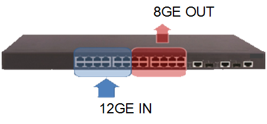
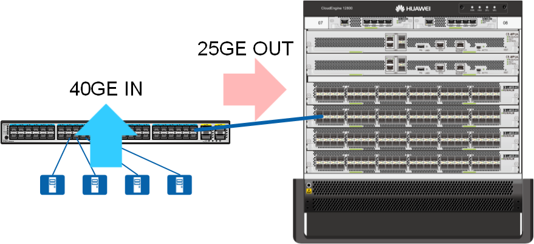
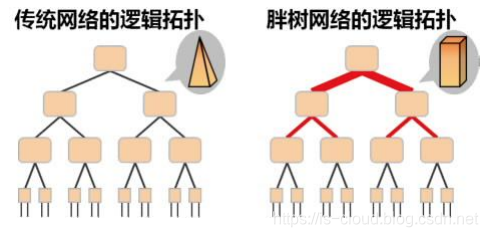

## 数据中心概述

数据中心（Data Center）———由计算机场地（机房），其他基础设施，信息系统软硬件、信息资源（数据）和人员以及相应的规章制度组成的实体。

互联网数据中心（Internet Data Center）——拥有完善的设备（包括高速互联网接入带宽、高性能局域网络、安全可靠的机房环境等）、开展互联网w业务的数据中心。

算力已经成为人工智能、元宇宙的第一关键要素，在数字经济中扮演着越来越重要的角色。算力集群主要是 3 类，即

- 高性能计算算力集群（HPC/ 超算计算中心）
- 人工智能计算算力集群（AI计算中心或智算中心）
- 通用计算算力集群（云与大数据 数据中心）
  过去这 3 类算力集群以烟囱化建设模式为主，未来将走向融合建设的模式。比如：HPC+AI 可以极大的提升传统 HPC 的计算效率，短期天气预报就是一个融合 AI、大数据和科学计算的典型实例。
  未来，新型数据中心将是提供多样性计算综合能力的算力集群，以满足千行百业智能化的需求。
  https://www.vertiv.cn/48ea47/globalassets/documents/white-papers/evolution-of-intelligent-data-center-infrastructure.pdf

数据中心内通常会存在三大资源区：通用计算区、高性能计算（HPC）区和存储区

- 通用计算区
  与数据中心外部的用户对接，提供指定的应用服务。这个区域中的服务器大量使用虚拟化、容器等技术，形成灵活的资源池来承载应用。本区域中的网络被称为应用网络、业务网络或前端网络，当前部署的是以太网。

- 高性能计算区
  配备了专用的高性能单元（如 CPU、GPU）的服务器，完成指定的高性能计算任务或 AI 训练。这个区域中的服务器一般很少使用虚拟技术。本区域中的网络被称为高性能计算互联网络，当前部署的是 IB（InfiniBand）网络。

- 存储区
  采用专用的存储服务器，对各类数据进行存储、读写和备份。本区域中的网络一般被称为存储网络，通常部署的是 FC（Fibre Channel）网络。

东数西算，即我国的东数西算工程，是指通过构建数据中心、云计算、大数据一体化的新型算力网络体系，将东部算力需求有序引导到西部，优化数据中心建设布局，促进东西部协同联动。
2022年2月，国家发改委、中央网信办、工业和信息化部、国家能源局，联合启动了东数西算。
在京津冀、长三角、粤港澳大湾区、成渝、内蒙古、贵州、甘肃、宁夏等8地启动建设国家算力枢纽节点，设立10个国家数据中心集群，正式拉开了构建全国一体化数据中心体系的大幕。

东数西算，只是“全国一体化大数据中心协同创新体系”的一个下辖概念，而后者旨在推进技术、业务、数据融合，实现跨层级、跨地域、跨系统、跨部门、跨业务的协同管理和服务，其实现方式不是固定不变的。
所以，不一定过度强调东数西算，面对不同应用场景，还可能有东数东算、南数北算等模式，应因地制宜。但无论哪种模式，都有着共同的目标：
促进数据中心资源最大化共享、流通和利用；通过数据中心的系统化布局，促进国家碳达峰、碳中和战略实现。

总的来说，东数西算不仅是简单的算力布局、网络布局、数据布局，更是生态布局。随着东数西算的逐渐深入，其应用潜力将不断释放，应用前景无限可期。
当万事万物都离不开算力时，一个崭新的算力经济时代正在到来。

伴随东数西算、算力网络、一体化大数据中心、智能计算中心等战略工程的推进，我国计算产业迈入新的高速发展阶段。
新阶段带来了很多挑战，同时也给整个计算产业界带来更多机遇，新技术、新产品、新业态、新商业模式正在大量涌现。

算力的互联互通和统一调度是实现“东数西算”的一项基本条件，更是数据中心算力发展的必由之路。在当前的应用场景中，带宽不足导致的延迟是算力互联无从避免的局限性。
按照目前的架构，举例来说，如果要将 4TB 的原始数据从北京传输到无锡，即使使用目前最快的网络，并保证网络无故障的情况下，数据传输时间将高达 5 天。
中国创新的提出了“算力网络”的概念，旨在通过网络将全国各个算力中心连接起来，形成一台庞大的“网络计算机”。一方面要提高算力输送效率，通过并网实现高带宽、低延迟的算力互联；
另一方面，需要团结领域内各大企业，可以屏蔽异构基础设施的差异，通过统一编程框架和编译的资源管理与调度软件实现算力的互通和资源的统一调度和管理，稳步推进“东数西算”的发展与预后工作。
实现全社会算力资源的使用最优、效率最高。

数据中心网络作为支撑云计算、大数据等数字业务的核心基础设施，其安全性不容忽视。近年来网络攻击技术呈现智能化、产业化升级趋势，攻击手段更加隐蔽复杂，攻击频率与规模持续攀升。
数据中心网络面临严峻的安全威胁：外部攻击（如勒索软件）可致服务瘫痪，内部权限滥用或运维失误易导致数据泄露，虚拟化漏洞与东西向流量盲区更可能引发系统性崩溃。
正因如此，网络安全建设成为数据中心存续的刚需。这不仅是守护业务命脉的防线，更是构筑数据资产护城河的核心手段。

对企业来说，数据中心实际上就是个人电脑的扩大版，承担着企业数据的计算、存储和转发的重任。现代数据中心主要包括以下几个部分：
• 计算系统，由大量的服务器设备组成，是数据中心的心脏，负责数据中心海量数据的处理。
• 存储系统，由不同类型的存储设备组成，存储设备是海量数据储存的地方，是用于信息储存的设备。
• 数据中心网络，由不同类型的网络设备组成，如交换机、防火墙等，负责衔接数据中心内部的计算系统和存储系统，它们之间的所有数据交互都要通过数据中心网络实现。

## 数据中心配电方案

数据中心供配电系统：为机房内所有需要动力电源的设备提供稳定、可靠的支撑。
一般来说，A级数据中心采用双路电源供电，10kv市电进线到数据中心服务器的末端，常见的两路供电同时处于热备份状态，一路断电时另一路会支持关键负载持续供电。
从上游到下游包括中压柜、变压器、低压配电柜，配电柜进线进到UPS，通过整流再给到PDU做最终分配，分配给各个服务器。

2N系统：2个供配电单元同时工作，互为备用，每个单元均能满足全部负载的用电需要。正常运行时，每个单元向负载提供50%的电能；当一个单元因故障停止运行时，另一个单元向负载提供100%的电能。 可克服单电源系统存在的单点故障瓶颈，增强供电系统可靠性。

DR系统：分布冗余。由N(N≥3）个配置相同的供配电单元组成，N个单元同时工作。将负载均分为N组，每个供配电单元为本组负载和相邻负载供电，正常运行下，每个供配电单元的负荷率为66%。当一个供配电系统发生故障时，其对应负载由相邻供配电单元继续供电。

RR系统：后备冗余。由多个供配电单元组成，其中一个单元作为其它运行单元的备用。当一个运行单元发生故障时，通过电源切换装置，备用单元继续为负载供电

两路市电：每一路市电供电容量满足数据中心全部电力需求，两路电源负荷设备输入端自动切换，正常时同时供电，各承担50%负载。
柴油发电机：独立于正常电源，当正常电源发生故障时，作为备用电源承担数据中心正常运行所需要的用电负荷。

柴油发电机组是数据中心的后备电源之一，独立于正常电源，由柴油内燃机组、同步发电机、油箱、控制系统4个部分组成，柴油为燃料产生高温、高压燃气，燃气膨胀推动活塞使曲轴旋转产生机械能，最终机械能转换为电 能输出。市电故障时ATS（自动转换开关）自动将电源切换到发电机作为主电源，发电机快速启动并对外输出稳定可靠的电能，保障数据中心正常运行

变压器：将市电6kV/10kV/35kV(3相)转换成380V/400V(3相)，供后级低压设备用电。

UPS：挂载的蓄电池与主机相连接，通过主机逆变器等模块电路为重要服务器负载持续供电，保证数据中心不断电，同时能净化电网。

断路器：接通、承载以及分断正常电路条件下的电流，也能在规定的非正常电路(例如过载、短路)下接通，承载一定时间和分断电流。

空调系统：由制冷循环和空气循环组成，制冷循环即利用有限的制冷剂在封团的制冷系统中，不断的在基发器处吸热汽化，进行制冷降温，将热量从室内微运到室外，主要分为水冷和风冷两类。

其他系统：保障数据中心的正常运转、安全管理及高效运营的其他系统，包括照明系统、消防系统、网络设备系统、监控系统等。

冗余架构与容错（可用性）
核心目标是实现 “无单点故障” 和 “带电可维护”。

- 2N 或 2(N+1) 架构：
- 2N（双路冗余）： 部署两条完全独立、容量均满足全部 IT 负载需求的供电路径（A 路和 B 路），它们共享同一负载，任一路径故障都不会中断供电。
- 物理隔离： A/B 两路电源电缆、配电柜、UPS 房必须在物理上隔离，避免单一事件（如火灾、水淹）同时破坏两条路径。
- 模块化 UPS 系统：
- 采用 模块化 UPS 设计，允许在系统在线运行时添加、移除或更换冗余模块（N+X 冗余），实现了真正的带电维护。
- 独立电池组： 在 2N 架构中，A 路和 B 路必须配备各自独立的电池组，防止一侧电池故障影响另一侧。
- 自动转换开关 (ATS) 和 STS：
- ATS (Automatic Transfer Switch)： 用于在双路市电（或市电和发电机）之间进行自动、可靠的切换。
- STS (Static Transfer Switch)： 用于机柜或机架级，在 IT 负载的双电源输入端，实现 A 路和 B 路 UPS 电源之间的毫秒级无缝切换，确保服务器不中断。

蓄能与后备电源技术（可靠性）

- 发电机组并联运行： 多台发电机采用并机方式运行（N+1 冗余），当单台故障时，其余发电机可继续支撑负载。
- 储能技术：
- 锂电池 (Lithium-Ion)： 正在取代传统的铅酸电池。锂电池具有体积小、重量轻、寿命长、放电深度大、能量密度高等优势，但对温控和消防要求更高。
- 飞轮（Flywheel）： 在某些高端机房作为短时备用，其放电时间极短但寿命长，用于填补市电中断和发电机启动之间的毫秒级真空。

芯片单体功耗急速增加，带动单台服务器功耗提升。芯片方面，英伟达的H100和H200单芯片功耗为700W，GB200达到2700W，单芯片功耗显著提升；
服务器配置方面，NVL32 GPU数量为32颗，GB200 NVL72架构则需要72颗，单机柜部署4台服务器至9台服务器，整体功率要求大幅提高。
传统每台8卡AI服务器的功耗在5kW～10kW，进一步由服务器组成整体机柜时，单机柜的功率将达到40kW以上。
HGX系列单台服务器功耗从Hopper架构的10.2kW提升到Blackwell架构HGX B200的14.3kW，而NVL72单机柜功耗提升到120kW。

## 数据中心网络架构

### 流量收敛

数据报文的流量收敛，是指数据报文在网络转发过程中由于架构、设备等非故障原因而不能实现线速无丢包转发。在流量收敛时，网络设备会有部分端口拥塞，进而丢弃部分报文。

为了能够描述不同的收敛程度，我们通常用一个系统所有南向（下行）接口的总带宽比上这个系统所有北向（上行）接口总带宽的数值来表示，我们也将这个数值称为这个系统的收敛比。

举个例子，假设有10台服务器，每台服务器通过10GE的接口连接到一个接入交换机，那我们一共就有100G（10×10G=100G）的南向带宽。
假设这台交换机还有2个40GE的接口可以用于接入到更高一层的汇聚交换机，那我们一共就有80G（2×40G=80G）的北向带宽。此时，我们得到的收敛比则是1.25：1（100G÷80G=1.25）

造成网络流量收敛的原因并不总是上述描述的这个例子，不过总的来说，我们可以将流量收敛的原因分为两类：

- 交换机不支持线速转发，在交换机内部可能形成流量收敛；
- 网络架构设计的原因，无论交换机是否线速，转发报文时也会存在流量收敛。

  1.交换机非线速转发带来的收敛

某交换机只具有8Gbps线速转发的交换能力，某时刻从交换机前12个接口向后12个接口同时转发流量，当每个接口流量均达到1Gbps时，在交换机内部一定会有拥塞，此时便形成了转发的收敛。
实际每秒交换机接收流量为12Gbps，但转发出去的报文只有8Gbps，收敛比为输入带宽(12Gbps)÷输出带宽(8Gbps)=1.5:1

2.网络设计导致的收敛
4台服务器分别通过10GE链路连接接入交换机，接入交换机通过1条25GE链路连接核心交换机。即接入交换机的下行带宽为40Gbps，接入交换机的上行带宽为25Gbps。
下上行链路收敛比为下行带宽（40Gbps）÷上行带宽（25Gbps）=1.6：1

当然，最理想的收敛比是1：1。但是我们也会注意到，低收敛比的设计意味着选用更高上行端口带宽的设备，这意味着更多的投入；如果在不计成本的情况下，1：1的收敛比是我们都期望能实现的。
另外一方面，我们的服务器也不是每时每刻都工作在高负荷下，占用100%的带宽。这意味着即使不是1：1的收敛比，也不是就一定会出现数据报文因拥塞丢包，业务仍可以正常运行。
因此，找到这两者之间的平衡，找到最适合的收敛比，就显得十分有必要。

收敛比反映了一个网络线速转发流量的能力，因此通常我们会把收敛比作为衡量一个高性能网络的因素来考虑。
一般在园区网，由于流量压力不大，园区网网络一般都会存在较大的流量收敛；但在数据中心网络，由于其对性能要求高，流量收敛的设计就十分重要。

### 胖树结构

对于早期的数据中心，其业务主要是数据中心外部对数据中心的访问，因此流量以南北向为主。
基于业务特征，以及出口带宽的限制，网络的设计一般是按照一定的比例逐级收敛的，即：数据中心网络接入侧的带宽，是网络汇聚区/核心区带宽的数倍。常见的带宽收敛比为：1：3～1：20
而随着云计算的到来，越来越丰富的业务对数据中心的流量模型产生了巨大的冲击，如搜索、并行计算等大数据业务，需要大量的服务器组成集群，协同完成工作，这导致服务器之间的流量变得非常大。

另外，云计算时代复杂多变的需求，也带来了流量的不确定性，我们无法再准确预测服务器的流量，无法再通过设计来规划网络的带宽。
同时，虚拟化所带来的虚拟机动态迁移能力，又进一步导致网络流量模型愈趋复杂、东西向流量愈趋增大。

随着数据中心流量模型的改变，传统的收敛网络将不再满足数据中心的业务需求。我们需要在数据中心内部署无阻塞的网络，即：数据中心内部，任意服务器之间可以线速交互流量

当前，业界普遍认可的实现无阻塞网络的技术是：胖树架构（Fat-Tree，由 Charles E. Leiserson 于上个世纪八十年代提出）其基本理念是：使用大量低性能的交换机，构建出大规模的无阻塞网络。

传统的树形网络拓扑中，带宽是逐层收敛的，树根处的网络带宽要远小于各个叶子处所有带宽的总和。而胖树网络则更像是真实的树，越到树根，枝干越粗，即：从叶子到树根，网络带宽不收敛。
为了实现网络带宽的无收敛，胖树网络中的每个节点（根节点除外）都需要保证上行带宽和下行带宽相等，并且每个节点都要提供对接入带宽的线速转发的能力。
这是胖树架构能够支撑无阻塞网络的基础。

在胖树架构中，为了实现弹性的扩展，树根节点预留了和下行接入能力相同的上行带宽。
而在数据中心实际的建设中，整个网络的规模是可以提前预知和规划好的（比如：受机房空间的限制，不可能无限扩容），因此树根处一般不需要预留如此大规模的上行带宽。

胖树架构的理论模型中，整个网络都采用相同性能的物理交换机，而实际的数据中心网络中，接入交换机由于只负责少量的服务器的接入，在转发能力要求上，要比汇聚交换机和核心交换机低很多。
因此，我们通常在 TOR的位置使用盒式交换机，而在汇聚区、核心区使用高性能框式交换机，在满足网络需求的同时，还可以达到增强网络性能、简化网络部署的目的。

从胖树架构的拓扑中可以看到，胖树网络中是存在环路的，为了实现无阻塞的交换，我们不能使用 STP 这种“阻断链路”的方式破环，而是要充分利用所有的链路资源。
当前比较成熟的技术，除了传统的路由协议（运行在三层 IP 网络中）之外，还有 TRILL 协议（运行在二层 ETH 网络中）
